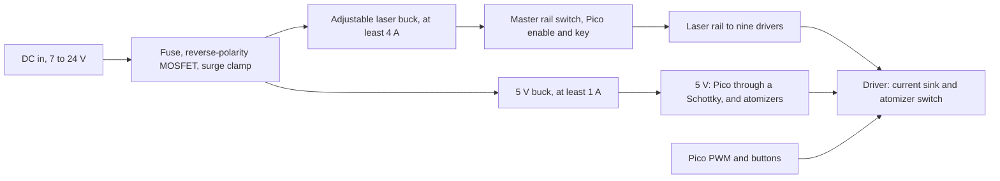

# Laser chanukiah: controller and driver

This describes the schematics in `controller/` and `driver_module/` as they stand after the redesign: what the circuits do, how the two laser configurations differ, the rules the firmware has to follow, and what to buy.

There are two boards.

- **Controller** (one): power input, the two buck-module connections, the master laser-rail switch, a Raspberry Pi Pico, nine buttons, and nine cables out to the drivers.
- **Driver** (nine, one per candle): a linear current sink for that candle's laser, and a switch for that candle's atomizer.

Candle 5 is the shamash. It uses the same hardware as the other eight. Firmware keeps it lit for the whole holiday; the circuit does not force it on.

## What the system is doing

Each candle has a button, a laser diode on its own small driver board, and, in the low-power configuration, an ultrasonic atomizer. Pressing the button is an input to the Pico. The Pico decides brightness and sends one PWM signal per candle. That one signal does both jobs on the driver: it sets the laser current, and it turns the atomizer on whenever the laser is on.

The laser is not pulsed. The PWM is only the Pico's way of producing an adjustable voltage. The driver filters it to DC and regulates a steady current. At 50% duty the laser runs continuously at half its full-scale current. It does not switch between full current and off.

Light output is not proportional to duty. A laser diode emits almost nothing below its threshold current. Above threshold, optical power rises roughly in proportion to current above that threshold. Firmware that wants a particular brightness has to convert it to a current above that diode's threshold. The threshold differs between the two laser types, and between individual diodes.



## The two configurations

The same boards support both. The only part that changes the laser current is a solder jumper on each driver.

| | Config A, Sony SLD3134VL | Config B, Osram PLPT5 447KA |
|---|---|---|
| Laser | 405 nm, 20 mW class. About 15–32 mA, forward voltage up to 5.2 V | 445 nm, 2 W class, run here at low current. About 300 mA, about 3.7 V typical |
| Driver JP1 | Open. This is the default, and how every board arrives | Bridged |
| Sense resistance | R1 alone, 7.5 Ω | R1 in parallel with R6, 7.5 Ω in parallel with 0.75 Ω, about 0.68 Ω |
| Full-scale current at 100% PWM | 27.5 mA | about 302 mA |
| Laser-rail setting, on the buck module's trimmer | about 6.0 V | about 5.0 V |
| Atomizers | Connected | Intended to be unplugged. The board still powers them if they are left connected |
| Safety | Lower power. The datasheet still rates the diode Class 3B | Safety glasses. Treat it as a Class 4 system: key switch, interlocks, no open beam |

Full scale is set by `I = Vset / Rsense`, with `Vset = duty × 3.3 V × 1 kΩ / (15 kΩ + 1 kΩ)`, so 0.206 V at 100% duty.

Bridging a driver's JP1 multiplies the current by about eleven. Do that only with an Osram diode fitted. A Sony diode would be destroyed. Leaving the jumper open, or bridging it badly, only reduces the current, back toward the config A level. It cannot increase it.

The controller has its own CONFIG jumper, a pin header rather than a solder bridge. It does not set the current. It tells the firmware which rail voltage and which brightness table to expect, so the firmware can reject a rail that is at the wrong voltage. Open reads as config A (the GPIO pull-up), closed to ground reads as config B. A missing shunt fails safe: the firmware sees config A and a 5 V rail looks out of range, so it should refuse to enable the lasers.

## Power

### Input

The controller expects 7–24 V DC, with 12 V as the nominal setting. A 12 V, 3 A bench supply covers every load below, including config B with all nine atomizers running.

The positive lead can go out through an external switch on `PWR_SW1`. Bridge that terminal if the switch is not fitted.

From the input terminal the current passes through:

1. A 4 A fuse, F101.
2. Q101, an AO4407A P-channel MOSFET used as reverse-polarity protection. Its body diode conducts first and then the channel turns fully on, so the drop is a few tens of millivolts instead of a diode drop. D102, a 12 V Zener, holds the gate-to-source voltage inside the MOSFET's ±20 V rating when the input is up at 24 V or during a surge. Below about 12 V the Zener does nothing, and the MOSFET simply sees the full input voltage, which is what it needs in order to turn on at 7 V.
3. D101, an SMAJ28A, clamps input surges. C101, 100 µF 35 V, sits on the protected bus.

R102 (100 kΩ) and R103 (10 kΩ) divide that bus down to ADC1. The divider reads up to about 36 V across the Pico's 3.3 V range.

### The two bucks

Both converters are off-the-shelf modules, wired to screw terminals. Both must accept at least 28 V on their inputs, so a supply set to 24 V still has margin.

- **5 V module**, at least 1 A. Its output is the +5 V rail: the nine atomizers (about 60 mA each, 0.54 A) plus the Pico. D103, an SS14 Schottky, feeds the Pico's VSYS from this rail and stops a USB cable from back-feeding 5 V into the atomizers. The Pico's VSYS pin accepts roughly 1.8–5.5 V, so the diode's few tenths of a volt of drop is fine.
- **Adjustable laser module**, at least 4 A. Set its output with its own trimmer: about 6.0 V for config A, about 5.0 V for config B. The drivers need the rail only a little above the laser's forward voltage. Extra voltage is burned in the driver's MOSFET, about 0.3 W per laser for every extra volt in config B, so do not run config B from 6 V.

### Master laser-rail switch

Q102, another AO4407A, sits between the laser buck's output and `LASER_RAIL`, which feeds all nine drivers. R104 (100 kΩ) holds its gate at the source, so the rail is off until something pulls the gate down.

Q103, a 2N7002, does that pulling, through R105 (10 kΩ). The Pico drives Q103 from GP18 (`LASER_EN`) through R106 (100 Ω), with R107 (100 kΩ) holding the gate off at boot.

`LASER_KEY1` is in series with Q103's source. It is a two-pin connector for a key switch, or for several interlock contacts wired in series (lid switch, emergency stop, key). The rail can come on only while that loop is closed, whatever the firmware does. A shorting plug makes the rail purely firmware-controlled. Firmware cannot see the key directly. It sees the result: R108 (100 kΩ) and R109 (47 kΩ) divide `LASER_RAIL` down to ADC0, which reads up to about 10 V.

C104, 470 µF 10 V, holds the rail up while a laser turns on.

### How much power

Nine candles at full scale, plus the Pico:

| Load | Config A | Config B |
|---|---|---|
| Lasers | 9 × 27.5 mA at 6 V, about 1.5 W | 9 × 0.30 A at 5 V, about 14 W, of which about 3 W is heat in the driver MOSFETs |
| Atomizers | 9 × 60 mA at 5 V, about 2.7 W | Same, if they are left plugged in |
| Pico | a few hundred milliwatts | a few hundred milliwatts |

Config B with atomizers is the worst case: about 17–18 W out of the converters, about 20 W from a 12 V supply at typical converter efficiency, so about 1.7 A. Size the input and the supply for at least 25 W. Config A with atomizers is about 5 W.

The laser rail's wiring on the controller is a copper pour, so the drop out to a driver is small. On a driver, config B still needs the rail at the board to be at least about 4.6 V for a high-forward-voltage Osram, and config A needs at least about 5.4 V for a high-forward-voltage Sony. That is why the two settings are 5.0 V and 6.0 V, and why the firmware should check the measured rail against the CONFIG jumper before enabling anything.

## Controller logic

### Pico pins

Candles 1–4 and 6–9 use GP0 through GP15, in candle order: PWM on the even pin, button on the odd pin. The shamash is the exception, because GP16 and GP17 share a PWM slice with GP0 and GP1, and each slice can only produce two independent duties. Putting the shamash PWM on GP17 uses the free half of slice 0. All nine PWM outputs are on distinct slices and channels, so the nine brightnesses are independent.

| Candle | PWM | Button |
|---|---|---|
| 1 | GP0 | GP1 |
| 2 | GP2 | GP3 |
| 3 | GP4 | GP5 |
| 4 | GP6 | GP7 |
| 6 | GP8 | GP9 |
| 7 | GP10 | GP11 |
| 8 | GP12 | GP13 |
| 9 | GP14 | GP15 |
| 5, shamash | GP17 | GP16 |

Other pins:

| Pin | Signal | Function |
|---|---|---|
| GP18 | LASER_EN | Turns the master laser-rail switch on. Active high |
| GP19 | CONFIG | Jumper to ground. Open = config A, closed = config B. Enable the internal pull-up |
| GP26 / ADC0 | laser rail | Through the 100 kΩ / 47 kΩ divider. Full scale about 10.3 V |
| GP27 / ADC1 | input voltage | Through the 100 kΩ / 10 kΩ divider. Full scale about 36 V |
| GP20, GP21, GP22, GP28 | spare | |

Buttons are wired to ground. A press reads low. There is no pull-up on the board; the firmware enables the Pico's internal pull-ups. There is no hardware debounce.

### Cable to a driver

Each candle has one four-pin JST ZH connector. The same pinout is on the driver.

| Pin | Signal |
|---|---|
| 1 | Laser rail |
| 2 | Ground |
| 3 | PWM, 0–3.3 V, 100 kHz |
| 4 | +5 V, the atomizer supply |

JST ZH contacts are rated 1 A. The heaviest pin here carries about 0.32 A, the config B laser current on pins 1 and 2.

## Driver

### Current sink

The laser anode goes to the laser rail. The cathode goes to the drain of Q1, an AO3400A. Q1's source goes to the sense resistance and then to ground.

U1, an LM321, compares the set-point voltage with the voltage across the sense resistance and drives Q1's gate until they match. R3 (1 kΩ) feeds the sense voltage back to the inverting input, C1 (10 nF) from the output back to that input, and R2 (470 Ω) in series with the gate keep the loop stable. The simulation shows no overshoot on a current step with these values.

The set point is the filtered PWM. R4 (15 kΩ) and R5 (1 kΩ) divide the 3.3 V PWM down by 16, and C2 (10 µF) to ground filters it. The time constant is about 9.4 ms, a corner near 17 Hz, so brightness can change over about 20 ms and the 100 kHz is reduced to a fraction of a percent. That 20 ms ramp is also the soft start: the laser current rises with the filter rather than in a step.

C5 (10 µF, 16 V) and C6 (100 nF) decouple the rail at the op-amp.

Q1 dissipates about `(Vrail − Vlaser − Vsense) × I`. In config A that is about 30 mW. In config B, on a 5 V rail with a typical diode, it is about 0.32 W, and it rises by about 0.3 W for every extra volt of rail. The driver PCB gives Q1's drain about 1.3 cm² of copper across both layers, stitched with vias, which should keep the temperature rise near 40–50 °C at 0.32 W. Check one board at full config B current before committing to all nine. Do not raise the config B rail to get more brightness; change a sense resistor instead (a smaller R6 raises only config B, a smaller R1 raises both).

### Choosing the configuration

JP1 is an open solder jumper, the footprint `SolderJumper-2`, rounded pads. It is not a part you buy.

- Open: only R1 (7.5 Ω, 1%, 0805) is in circuit. Config A, 27.5 mA full scale.
- Bridged: R6 (0.75 Ω, 1%, 0805) is in parallel with R1. Config B, about 302 mA full scale. R6 dissipates about 60 mW, inside an 0805's 125 mW rating.

R1 and R6 are the only components that differ in value between configurations, and both are fitted on every board. Everything else is identical.

### Atomizer switch

Q2, a second AO3400A, switches the atomizer's negative lead to ground. The atomizer's positive lead is the +5 V pin from the controller, passed straight through to the atomizer connector.

Q2's gate is driven from the PWM pin through an activity detector: R7 (330 Ω) and D1 (BAT54J) charge C7 (47 nF), and R8 (220 kΩ) discharges it. While any PWM pulses are present the gate sits at about 2.6–3.2 V, enough for the AO3400A to pass 60 mA with a drop of a few millivolts. After the PWM stops, the gate falls and the atomizer is off in about 10 ms. At 1% duty the gate only reaches about 2.6 V, which is still enough; the AO3400A's gate threshold is about 1 V.

The 330 Ω resistor limits how hard the detector loads the PWM pin. The Pico pin sags by about 100 mV during the high time at 1% duty, which shifts the laser current by about 3% of that small current. At 50% duty the sag is about 10 mV, under 0.3%.

### Laser connector and protection

J3 is a three-pin JST ZH:

| Pin | Function |
|---|---|
| 1 | Laser diode anode, to the laser rail |
| 2 | Photodiode anode. Not connected. Neither configuration uses the monitor diode |
| 3 | Common, the laser diode cathode, to Q1's drain |

That pinout matches the Sony can. The Osram can is wired differently, so its leads or a small adapter have to put the anode on pin 1 and the cathode on pin 3.

Across the diode, from rail to cathode:

- D2, a BAT54J, clamps reverse voltage.
- D3, an SMAJ6.5CA bidirectional TVS, clamps transients. It does not conduct at the Sony's 5.2 V forward voltage.
- C4, 10 nF, absorbs fast spikes.

### What the simulation shows

`driver_module/sim/laser_sink.py` is an ngspice simulation of this driver, including the cable and the controller's rail switch. From `driver_module/sim/`:

```
python3 laser_sink.py
```

It needs ngspice, numpy, and matplotlib. One run takes about a minute and a half and writes plots to `driver_module/sim/plots/`.

The laser diodes are modelled from their datasheet forward voltages, including a high-forward-voltage corner for each. The op-amp is the manufacturer's LM358 model (the LM321 is the single version of that op-amp). The MOSFET is Alpha & Omega's AO3400 model with gate capacitance added to match the AO3400A datasheet. Results, at the schematic values:

| | Config A | Config B |
|---|---|---|
| Full-scale current | 27.4 mA, against 27.5 mA ideal | 300 mA, against 302 mA ideal |
| Worst case across 1% resistors, 7 mV of op-amp offset, and a 3.2–3.3 V PWM high level | 24.9–29.2 mA, inside the Sony's 32 mA | 273–319 mA |
| Rail voltage needed for regulation, typical diode / high-forward-voltage diode | 4.9 V / 5.3 V | 4.0 V / 4.6 V |
| Turn-on through the PWM filter | about 20 ms, no overshoot | about 20 ms, no overshoot |
| Current ripple from 50 mV of buck ripple | about 0.6% peak to peak, at the buck's switching frequency | about 0.7% peak to peak |

Connecting a laser to a driver that is already powered, with the set point already high, produces a pulse of about five times the set current in config A and about three times in config B. The op-amp model stops converging a fraction of a microsecond into that event, so the number is a lower bound on how bad it is. Connect lasers only with the rail off.

Switching the rail on with the set point already high did not overshoot in the latest run. That result uses an AO3401 model standing in for the AO4407A, so do not rely on it. Keep the sequencing rule below.

## Rules for the firmware

There is no firmware in this repository. The circuit only behaves if these are followed.

1. Hold every PWM at 0 whenever the laser rail changes state: before asserting `LASER_EN`, and whenever ADC0 shows the rail collapsing (key opened, supply removed, buck current-limiting). Ramp the PWM up only after ADC0 reads a rail inside the expected window for the CONFIG jumper. About 5.4–6.5 V for config A and about 4.6–5.5 V for config B, measured at the rail, are reasonable windows.
2. Read CONFIG (GP19, pull-up) at startup. Open is config A.
3. Enable button pull-ups. A press is low.
4. Map desired brightness to a current above that laser's threshold, then to a duty. Store a per-candle calibration in flash; the hardware ceiling is fixed.
5. The shamash (candle 5, GP17) is kept on by firmware for the whole holiday. It still has to obey rule 1. Do not tie it to a constant high.
6. Never command current into a driver with no laser connected, and never plug a laser into a live driver.

## Parts to buy

Counts are for one controller and nine drivers. Unless noted, passives are 0805, 1% is only required where it says so, and capacitors other than the electrolytics are ceramic, X7R, rated 16 V or more.

### Semiconductors

| Qty | Part | Package | What it has to be |
|---|---|---|---|
| 18 | AO3400A, Alpha & Omega | SOT-23 | N-channel, 30 V. Must turn fully on at 2.5 V gate drive: the atomizer gate is only about 2.6 V at low duty. Buy the Alpha & Omega part; other makers sell different dice under similar names |
| 2 | AO4407A, Alpha & Omega | SO-8 | P-channel, 30 V, under about 15 mΩ at 4.5 V, gate rated ±20 V or more. Q101 carries the whole input current, Q102 the whole laser current. The schematic symbol is KiCad's FDS9435A with the value changed; the two have the same SO-8 pinout, but check the datasheet of the part you actually buy |
| 1 | 2N7002 | SOT-23 | Any 2N7002. It only switches the rail MOSFET's gate |
| 9 | LM321 | SOT-23-5 | Single op-amp, same family as the LM358. Inputs and output must work down to ground, and it must run from 6 V. Do not substitute a 5.5 V CMOS op-amp; config A runs the rail at 6 V |
| 18 | BAT54J | SOD-323F | Small Schottky, 30 V. Nine protect lasers, nine are the atomizer detectors |
| 9 | SMAJ6.5CA | SMA | Bidirectional TVS, 6.5 V working voltage, so it stays off at the Sony's 5.2 V |
| 1 | SMAJ28A | SMA | Unidirectional TVS, 28 V working voltage, across the input |
| 1 | BZT52C12 or MMSZ5242B | SOD-123 | 12 V Zener, 500 mW. Anything from 10 V to 15 V and 300 mW or more works. It only carries about 1 mA |
| 1 | SS14 | SMA | Schottky, at least 1 A and 20 V, low forward drop. A B5819W in SOD-123 is the same electrically if the footprint is changed |

### Passives

| Qty | Value | Package | Where | Note |
|---|---|---|---|---|
| 9 | 7.5 Ω, 1% | 0805 | Driver R1 | Sense resistor. Dissipates under 10 mW |
| 9 | 0.75 Ω, 1% | 0805 | Driver R6 | Config B sense resistor. About 60 mW in config B; an 0805 is rated 125 mW |
| 9 | 470 Ω | 0805 | Driver R2 | Gate isolation. The simulation depends on this value |
| 18 | 1 kΩ | 0805 | Driver R3, R5 | Feedback and the bottom of the PWM divider |
| 9 | 15 kΩ | 0805 | Driver R4 | Top of the PWM divider. Sets the 27.5 mA / 302 mA ceilings |
| 9 | 330 Ω | 0805 | Driver R7 | Atomizer detector |
| 9 | 220 kΩ | 0805 | Driver R8 | Atomizer detector discharge |
| 4 | 100 kΩ | 0805 | Controller R102, R104, R107, R108 | Dividers and pull-ups |
| 3 | 10 kΩ | 0805 | Controller R101, R103, R105 | Q101 gate, VIN divider, Q102 gate |
| 1 | 100 Ω | 0805 | Controller R106 | LASER_EN series resistor |
| 1 | 47 kΩ | 0805 | Controller R109 | Laser-rail divider |
| 18 | 10 nF | 0805 | Driver C1 and C4 | C1 compensates the current loop, C4 sits across the laser. Both values are the ones the simulation used |
| 9 | 47 nF | 0805 | Driver C7 | Atomizer detector |
| 9 | 100 nF | 0805 | Driver C6 | Rail decoupling. Two more, C102 and C105, are on the controller |
| 2 | 100 nF | 0805 | Controller C102, C105 | ADC filters |
| 9 | 10 µF, 16 V | 0805 | Driver C2 | Set-point filter. A 10 µF, 16 V ceramic also covers C5 |
| 9 | 10 µF, 16 V | 0805 | Driver C5 | Rail bulk at the op-amp. Can be the same part as C2 |
| 1 | 100 µF, 35 V electrolytic | 8 × 10.5 mm | Controller C101 | Input bulk |
| 1 | 100 µF, 10 V electrolytic | 6.3 × 7.7 mm | Controller C103 | 5 V rail |
| 1 | 470 µF, 10 V electrolytic | 8 × 10.5 mm | Controller C104 | Laser rail |
| 1 | 4 A fuse | 1206 | Controller F101 | Slow-blow is appropriate; the normal draw is under 2 A |

### Connectors, cables, and hardware

JST ZH is 1.5 mm pitch, 1 A per contact. Buy housings and crimp contacts to match.

| Qty | What | Notes |
|---|---|---|
| 18 | JST ZH, 4-pin, B4B-ZR, through-hole | Nine on the controller (DRV1–DRV9), nine on the drivers (J1, fitted on the underside) |
| 9 | JST ZH, 3-pin | Driver J3, the laser |
| 18 | JST ZH, 2-pin | Nine atomizer sockets on the drivers, nine button sockets on the controller |
| 1 | JST ZH, 2-pin | LASER_KEY1 |
| 9 | Four-wire cables, ZH plug at both ends | Laser rail, ground, PWM, +5 V. Keep them short, under about a metre; the simulation assumed 0.5 m |
| 9 | Two-wire cables to buttons | Or whatever the button hardware needs. The board end is a ZH plug |
| 9 | Two-wire leads to atomizers | ZH plug at the board |
| 9 | Three-wire leads to lasers | ZH plug at the board. Osram diodes need the anode on pin 1 and the cathode on pin 3 |
| 2 | 4-way screw terminal, 3.5 mm | The two buck modules |
| 2 | 2-way screw terminal, 3.5 mm | DC input and the power switch |
| 1 | 2-pin 2.54 mm header, plus a shunt | Controller CONFIG. Open is config A |
| 1 | Key switch, or an interlock loop | Across LASER_KEY1. Use a shorting plug if you are not fitting one |
| 1 | Power switch | In the positive input lead, optional |

The driver's solder jumper is pads on the PCB. Nothing to buy.

### Not on the boards

| What | Requirement |
|---|---|
| 5 V buck module | Fixed 5 V, at least 1 A out, input rated at least 28 V |
| Adjustable buck module | At least 4 A out, trimmable through 5.0–6.0 V, input rated at least 28 V. This is the laser supply |
| DC supply | 7–24 V, at least 25 W. 12 V at 3 A (36 W) covers config B with all nine atomizers, drawing about 1.7 A, and leaves margin. Set a current limit around 2.5 A so a short cannot deliver the supply's full output |
| Lasers | Nine Sony SLD3134VL, or nine Osram PLPT5 447KA, or a mix if you accept per-board jumper settings. Do not mix on one driver |
| Atomizers | The modules measured at 60 mA from 5 V. Their only connections are V+ and V−; V− must not be tied to chassis or to any other ground, because that would bypass Q2 |
| Pico | One Raspberry Pi Pico. USB supplies it only while programming; D103 keeps that off the 5 V rail |

## Boards

Both boards are routed and match their schematics. Fabrication outputs, Gerbers and drills, are in `controller/gerber/` and `driver_module/gerber/`, with zip files beside those directories. Regenerating them after any PCB edit matters more than reusing an old zip: the exports follow the board file.

Order the driver in a batch of nine, plus spares. Specify 1.6 mm, two layers, 1 oz copper, which is what the temperature estimate assumes. 2 oz copper on the driver would run Q1 cooler in config B.
